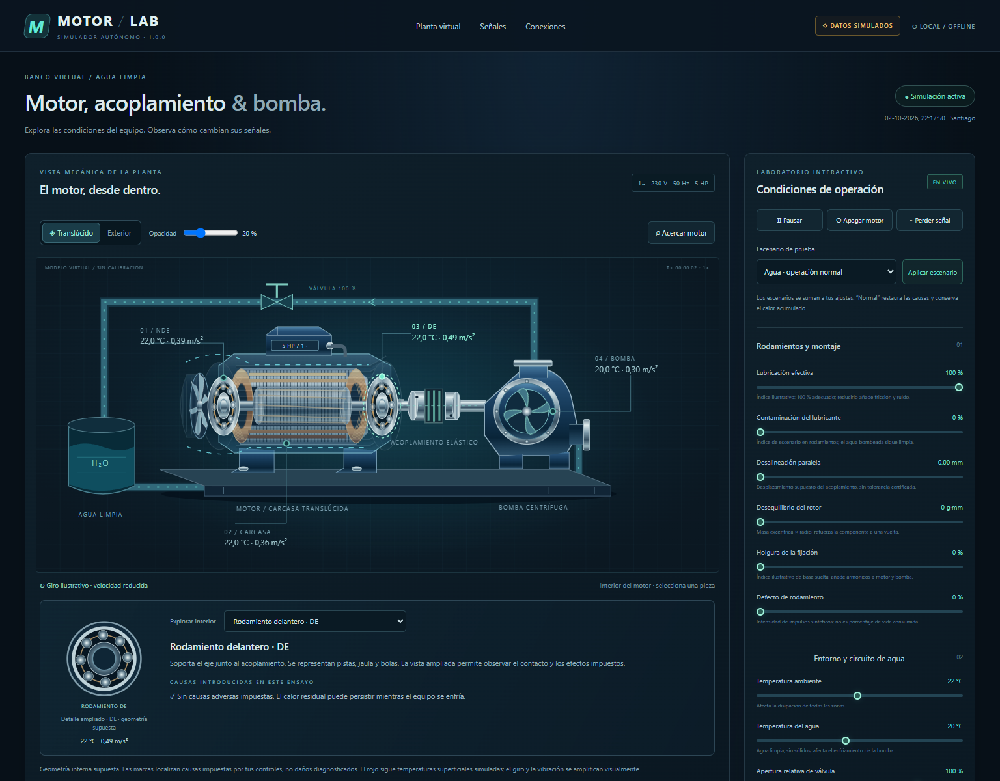
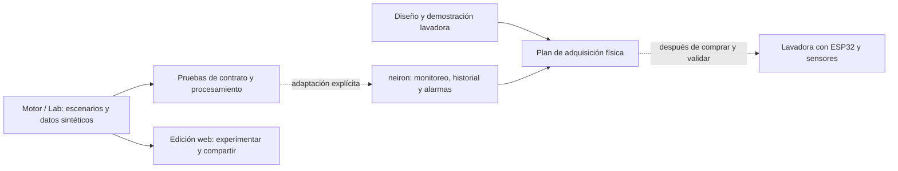
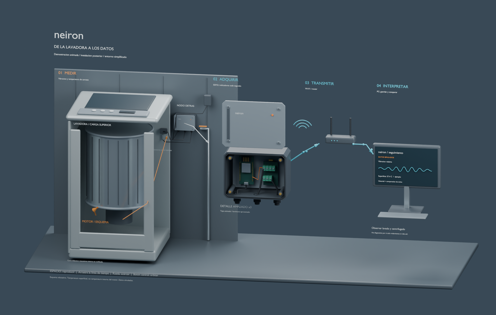
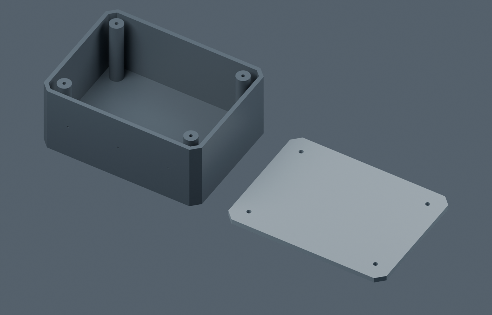

# neiron · Laboratorio de monitoreo IIoT

Proyecto de Javier ([javierah306-tech](https://github.com/javierah306-tech)) para explorar monitoreo accesible de temperatura y vibración, combinando diseño mecánico, electrónica prevista, software de registro y experimentación virtual.

**Estado al 13 de octubre de 2026:** gabinete y demostración Blender v03; aplicación neiron para monitoreo, historial, alarmas e intervenciones; Motor / Lab autónomo 1.0.0; edición web Motor / Lab 1.1.0. **Todas las lecturas disponibles son simuladas.** La lavadora será el primer ejemplo físico cuando se compren los accesorios. Hardware conectado, calibración y validación física pendientes; IA desactivada.

## Abrir Motor / Lab en el navegador

**[Abrir laboratorio virtual · sin instalar ni usar comandos](https://neiron-motor-lab.sunsetfly128.chatgpt.site)**

Cada visitante puede explorar motor monofásico de 5 HP, acoplamiento y bomba de agua, ver el interior del motor, modificar condiciones y descargar CSV/JSON de su ensayo. La simulación se ejecuta en su propia pestaña; tu PC puede estar apagado. No requiere cuenta ni Python para funcionar. Compatible por diseño con navegadores modernos; esta revisión probó Edge y un viewport móvil, no todos los navegadores ni teléfonos físicos.

## Propósito: de la idea a una prueba medible

neiron busca comprobar una cadena completa: **observar un activo → obtener datos con origen y unidades claros → guardarlos → mostrar cambios → registrar alarmas e intervenciones → contrastar el resultado con lo ocurrido**. Primero se desarrolló con simulación para poder probar esa cadena antes de disponer de electrónica y de un equipo instrumentado.

Motor / Lab se hizo como **banco de pruebas con datos sintéticos para comprobar el funcionamiento de la aplicación y de futuras integraciones**. Permite introducir causas conocidas —desalineación, poca lubricación o ventilación, entre otras— y observar señales diferentes. Facilita probar contratos, recepción, historial, exportación, recuperación de señal y visualización sin depender de un motor real. La edición web también permite que otras personas revisen el trabajo desde un enlace.

El laboratorio virtual reúne las ideas del proyecto: carcasa y distribución de componentes, explicación animada de sensores/ESP32/Wi-Fi/PC, aplicación neiron y experimentación motor–bomba. La tecnología e innovación están en unir diseño reproducible, instrumentación accesible y ensayos trazables. Su utilidad industrial deberá demostrarse con datos físicos; no se afirma una invención inédita, diagnóstico predictivo ni rendimiento ya validado.

**[Propósito, datos y relación entre las partes](docs/PROPOSITO_Y_DATOS.md)** · **[Plan preparado para la lavadora física](docs/PLAN_LAVADORA_FISICA.md)**

## Todo lo que ya tenemos

| Parte | Disponible | Para qué sirve / límite |
| --- | --- | --- |
| Diseño mecánico v03 | Gabinete angular/modular; cuerpo y tapa Blender/STL; renders; scripts generadores | Revisar distribución y preparar una impresión de ajuste. Junta, entradas, montaje y cotas reales pendientes. |
| Demostración de lavadora | Escena Blender de 240 fotogramas con sensores → ESP32 → Wi-Fi → PC | Explicar la arquitectura prevista; no comunica con sensores. |
| Aplicación neiron P01 | Monitoreo, SQLite, historial/CSV, alarmas con histéresis y reconocimiento, intervenciones | Probar gestión de datos con lavadora simulada. Recepción de datos físicos deshabilitada. |
| Banco motor–bomba 0.2 | Emisor y receptor separados dentro del paquete neiron | Antecedente de integración; conservado para trazabilidad. |
| Motor / Lab 1.0.0 local | Modelo reducido, cuatro zonas, señales triaxiales, controles, SQLite, REST/SSE, POST local opcional | Banco autónomo reutilizable. Envío voluntario; no está conectado automáticamente a neiron. |
| Motor / Lab Web 1.1.0 | Animación/inspector conservados, física JavaScript, escenarios, CSV/JSON | Compartir ensayos desde el navegador; datos de cada pestaña en memoria, sin base central. |
| Documentación y verificación | Arquitectura, contratos, guías, resultados, historia, empaquetador y sumas SHA-256 | Reproducir y distinguir lo implementado, lo histórico y lo pendiente. |

**[Inventario, revisión y verificación de esta entrega](docs/REVISION_2026-10-13.md)** · [Evoluciones del proyecto](docs/ROADMAP.md)

## Cómo se complementan las versiones

El contrato autónomo de Motor / Lab y el de neiron requieren un adaptador validado; no se asume que sean intercambiables. Los controles del simulador introducen causas conocidas; el programa no las descubre mediante un diagnóstico.

## Datos y límites de la edición web

- Temperatura superficial sintética en °C y aceleración RMS vectorial en m/s², con componente DC eliminada, en NDE, carcasa, DE y bomba.
- Ventanas sintéticas de 1.000 muestras por eje/1 s; publicación aproximada de un paquete por segundo activo. El visor muestra 120 ms; los archivos exportan agregados, no las ventanas completas.
- CSV: zona, señales, hora UTC, identidad/secuencia, versión, semilla, revisión y parámetros del ensayo. JSON añade eventos y paquetes.
- Últimos 3.600 paquetes por pestaña; gráficos de 240. Cerrar o recargar inicia otro ensayo: **descargar antes de cerrar**. Pestaña oculta suspende el avance y al volver espera datos nuevos.
- Sin recolección central de visitantes, SQLite ni REST/SSE/POST en esta edición. Esos servicios pertenecen a la versión local.
- Modelo sin calibrar, geometría supuesta y umbrales visuales ilustrativos. No estima vida útil, no certifica protección IP y no valida una IA con datos reales.

## Entregas y documentación

**[Motor / Lab local · código editable ZIP](entregas/motor-lab-1.0.0-vista-mecanica.zip)** · [Guía local](docs/MOTOR_LAB.md) · [Guía web](web/README.md) · [SHA-256](entregas/SHA256SUMS.txt)

Para la versión local Windows, extraer el ZIP completo, preparar Python 3.12 y abrir `MotorLab/iniciar.bat`; `cerrar.bat` guarda y cierra. [neiron local](software/README.md) inicia con `software/iniciar.bat`. Los datos operativos se almacenan fuera del repositorio. El acceso Windows `.lnk` conserva ese funcionamiento local; el enlace público de arriba es la alternativa para compartir.

Modelos en `04_PROTOTIPOS_3D/blend_files/`; STL en `04_PROTOTIPOS_3D/impresion_prueba/`. Conjunto nominal 120 × 90 × 55 mm; cuerpo 51 mm y tapa 4 mm. [Guía mecánica](04_PROTOTIPOS_3D/GUIA_ENTREGA_V03.md) · [Scripts Blender](03_SCRIPTS_BLENDER_CODEX/README_SCRIPTS.md). Los generadores reinician la escena: ejecutarlos en un proceso independiente y conservar sus dependencias.

## Próximo paso acordado

Comprar y confirmar ESP32 de 30 pines Micro USB, MPU6050 GY-521, DS18B20 y alimentación externa regulada USB 5 V/2 A; después seguir el [plan de lavadora](docs/PLAN_LAVADORA_FISICA.md). Ese documento define tareas previas, adquisición, registro, ensayos y criterios de avance; no presenta firmware inexistente como terminado.

[Arquitectura](docs/ARQUITECTURA_SOFTWARE.md) · [Contrato neiron](software/CONTRATO_DATOS.md) · [Resultados anteriores](docs/RESULTADOS_2026-10-02.md) · [MACHINA: evaluación opcional histórica](docs/MACHINA.md)

Licencia del trabajo propio pendiente de decisión del autor. La licencia de MACHINA no se aplica automáticamente a neiron. El portafolio excluye bases operativas, credenciales, respaldos completos y fotografías domésticas originales.
